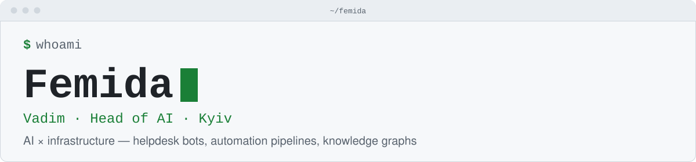
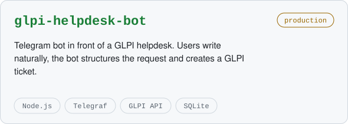
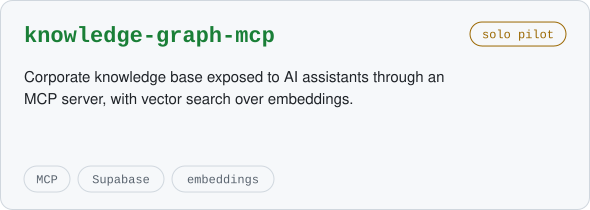
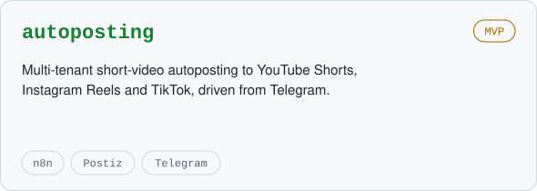
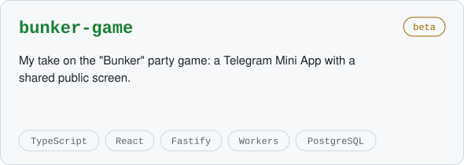
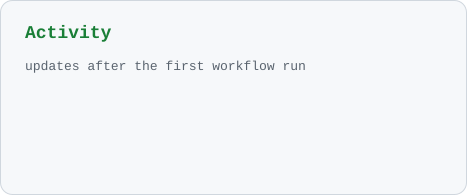

<picture>
<source media="(prefers-color-scheme: dark)" srcset="assets/banner-dark.svg">

</picture>

Head of AI at a Ukrainian retail company, based in Kyiv. I started and lead the company's AI direction. Before that I worked there as a sysadmin/DevOps engineer from 2024, on Microsoft-based infrastructure for 400+ users across 70 locations. Before IT I was a game designer (2020–2024).

I build practical tools where AI meets infrastructure: helpdesk bots, automation pipelines and knowledge bases that AI assistants can use.

### Currently

- Running local LLMs on a Tesla P40 in a dedicated VM
- Building AI assistants for retail: a customer-facing consultant and internal support
- Running AI training for management

### Projects

<table>
<tr>
<td width="50%">
<a href="https://github.com/Fem10da/glpi-helpdesk-bot">
<picture>
<source media="(prefers-color-scheme: dark)" srcset="assets/card-glpi-dark.svg">

</picture>
</a>
</td>
<td width="50%">
<a href="https://github.com/Fem10da/knowledge-graph-mcp">
<picture>
<source media="(prefers-color-scheme: dark)" srcset="assets/card-kg-dark.svg">

</picture>
</a>
</td>
</tr>
<tr>
<td width="50%">
<a href="https://github.com/Fem10da/autoposting">
<picture>
<source media="(prefers-color-scheme: dark)" srcset="assets/card-autoposting-dark.svg">

</picture>
</a>
</td>
<td width="50%">
<a href="https://github.com/Fem10da/bunker-game">
<picture>
<source media="(prefers-color-scheme: dark)" srcset="assets/card-bunker-dark.svg">

</picture>
</a>
</td>
</tr>
</table>

Also built, private for now: password-manager-bot (Telegram password generator and manager) · fridge (food inventory with budget and expiry tracking).

### Stack

<picture>
<source media="(prefers-color-scheme: dark)" srcset="assets/stack-dark.svg">

</picture>

### Activity

<picture>
<source media="(prefers-color-scheme: dark)" srcset="stats/stats-dark.svg">

</picture>
<picture>
<source media="(prefers-color-scheme: dark)" srcset="stats/langs-dark.svg">

</picture>

Updated daily by a GitHub Action in this repo; includes private repositories.

### Contact

- Telegram: [@f3m1da](https://t.me/f3m1da)
- Email: admin@f3mida.tech
